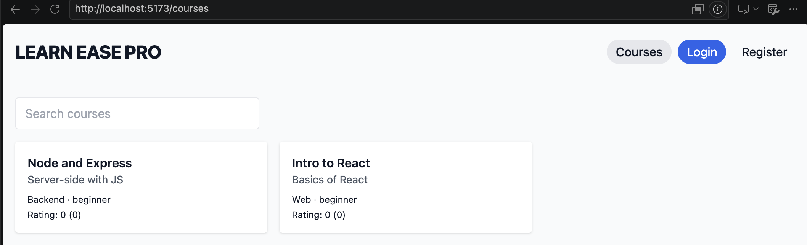
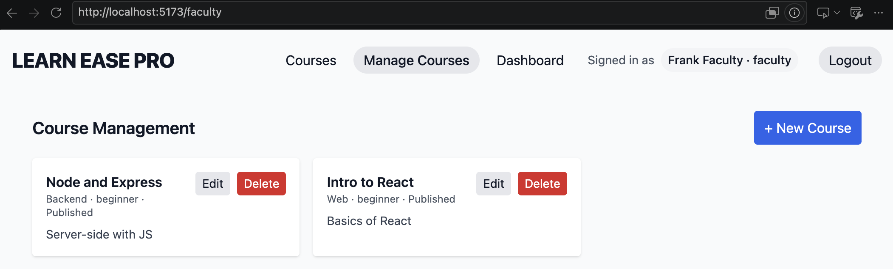
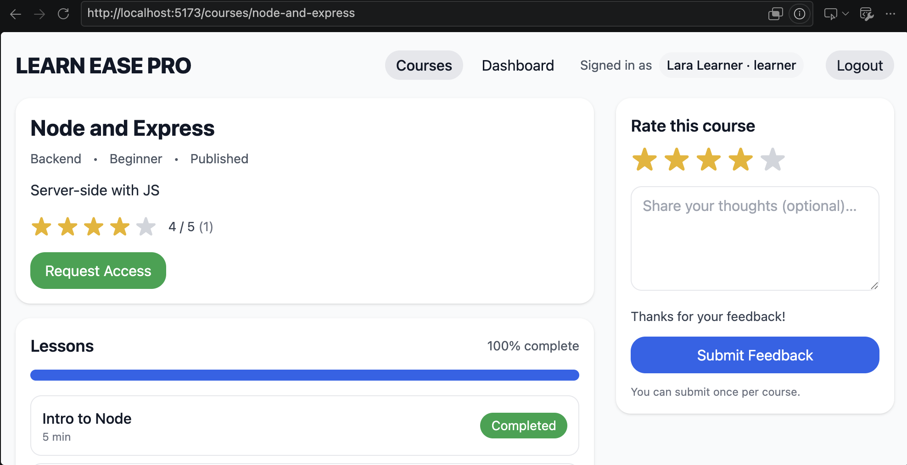

# Learn-Ease Pro LMS

A full-stack learning management system built with React, Node.js, Express, and MongoDB. Learn-Ease Pro supports three roles—learner, faculty, and administrator—and covers the core course lifecycle: creating and publishing courses, managing lessons, requesting and approving enrollment, tracking lesson progress, and submitting course feedback.

This is a **portfolio project**, not a production-hosted LMS. The focus is on full-stack application development, REST API design, authentication, resource-level authorization, troubleshooting, and automated regression testing.

## Tech stack

| Layer    | Technologies                                            |
| -------- | ------------------------------------------------------- |
| Frontend | React 18, React Router, Vite, Tailwind CSS, Axios       |
| Backend  | Node.js, Express, REST APIs, JWT authentication, Multer |
| Database | MongoDB with Mongoose models                            |
| Testing  | Node.js built-in test runner, Cypress end-to-end tests  |

## Application Screenshots

### Course Catalog



### Faculty — Course Management



### Learner — Course Progress



## Architecture

```text
React SPA (frontend/src)
    |
    | Axios -> /api/v1
    v
Express app (backend/src/app.js)
    |
    +-- routes / auth and role middleware
    |
    +-- controllers / resource ownership checks
    |
    +-- Mongoose models --> MongoDB
    |
    +-- Multer uploads --> local uploads/ (public URLs)
```

The backend is separated into `routes`, `controllers`, `middleware`, and `models`. Routes handle HTTP entry points; controllers apply request logic and resource-level permissions; Mongoose models represent users, courses, lessons, enrollments, progress, and feedback. The React frontend uses a shared Axios client and role-aware navigation.

## Main features and access rules

| Role          | Capabilities                                                                                                                      |
| ------------- | --------------------------------------------------------------------------------------------------------------------------------- |
| Visitor       | Browse published courses and view published course details                                                                        |
| Learner       | Register/sign in, request enrollment, view course material, track progress after approval, and submit feedback                    |
| Faculty       | Self-register, create/edit/publish owned courses, manage lessons, approve enrollments for their courses, and delete owned courses |
| Administrator | View/manage courses, approve enrollments, manage user listings, and delete courses                                                |

Authorization is enforced on the server, not solely through the React UI:

- Public registration permits `learner` or `faculty` (default: `learner`); requests for `admin` or unknown roles are rejected. Administrators are provisioned through the seed data, not public registration.
- Course updates and deletions require ownership or administrator privileges.
- Unpublished courses are omitted from the public catalog. Draft details can be retrieved by their faculty owner or an administrator with a verified token.
- Faculty enrollment approval is limited to enrollments for their own courses; administrators can approve across courses.
- Marking lesson progress requires an approved enrollment in the corresponding course.
- File uploads require faculty/administrator authentication and accept only `.pdf`, `.mp4`, and `.webm` files, with a 25 MiB limit.

These checks cover the listed operations; they are **not** a claim of a complete security audit of every endpoint.

## Local setup

### Prerequisites

- Node.js and npm (the verified Cypress run used Node.js 22.19.0)
- A running MongoDB instance reachable at the configured `MONGODB_URI`
- Separate terminal sessions for MongoDB, backend, and frontend

### 1. Install backend and configure environment

```bash
cd backend
npm ci
cp .env.example .env
```

The backend example file contains:

```dotenv
MONGODB_URI=mongodb://localhost:27017/learn-ease-pro
PORT=5050
JWT_SECRET=replace-with-a-long-random-secret
REFRESH_SECRET=replace-with-a-different-random-secret
CORS_ORIGIN=http://localhost:5173
```

Set secrets in your local `.env`; don't commit real credentials. Start MongoDB before starting the server.

**Optional: seed demo users and courses (destructive).** The current `npm run seed` script deletes **all existing users, courses, and lessons** in the configured database before inserting demo records. Run it only against a disposable local development database; it does not reset every related collection.

```bash
npm run seed
npm run dev
```

The backend listens on `http://localhost:5050` by default. Test the health endpoint at `http://localhost:5050/api/v1/health`.

If you seeded a disposable local database, the demo accounts use the password `Secret123!`:

| Role          | Email                 |
| ------------- | --------------------- |
| Administrator | `admin@example.com`   |
| Faculty       | `faculty@example.com` |
| Learner       | `learner@example.com` |

**Never use these demo credentials in a real deployment.**

### 2. Install and run frontend

In a second terminal, from the repository root:

```bash
cd frontend
npm ci
cp .env.example .env
npm run dev
```

`frontend/.env.example` sets `VITE_API_URL=http://localhost:5050/api/v1`. Open `http://localhost:5173`.

### 3. Run tests

**Backend regression suite** (from `backend/`):

```bash
npm test
```

**Frontend production build** (from `frontend/`):

```bash
npm run build
```

**Cypress** (from repository root; the frontend and backend must be running, and the configured database must be available):

```bash
npm ci
npx cypress run
```

For an interactive test runner, use `npx cypress open` from the repository root. Cypress configuration in `cypress.config.js` expects the frontend at `http://localhost:5173` and API at `http://localhost:5050/api/v1`. The tests expect suitable local demo accounts/test data; use a disposable development database.

## Verification performed (October 2026)

| Verification                   | Result                          | Scope                                                                                                                                      |
| ------------------------------ | ------------------------------- | ------------------------------------------------------------------------------------------------------------------------------------------ |
| Backend tests                  | **52 passing, 0 failing**       | Authentication/role validation, ownership, course visibility and cleanup, progress, and HTTP upload restrictions                           |
| Cypress                        | **10 passing, 0 failing**       | Smoke/login/API health (3), course create/publish/update/delete (4), role-aware routes (3)                                                 |
| Vite production build          | **Passed**                      | `npm run build`; browser-data freshness warnings did not block compilation                                                                 |
| Manual browser/database checks | **Passed for tested scenarios** | Faculty could edit drafts; faculty/admin course deletions removed associated lesson, enrollment, feedback, and progress records in MongoDB |

Most backend tests isolate controller or middleware behavior with mocked database calls. Upload tests exercise actual multipart requests through the Express upload router. Cypress exercises selected browser/API workflows; it is not exhaustive application coverage.

## API overview

Routes are prefixed with `/api/v1`. Examples:

| Method         | Route                        | Purpose                                           |
| -------------- | ---------------------------- | ------------------------------------------------- |
| `POST`         | `/auth/register`             | Register learner/faculty                          |
| `POST`         | `/auth/login`                | Authenticate                                      |
| `GET`          | `/auth/me`                   | Read authenticated user                           |
| `GET`          | `/courses`                   | List published courses                            |
| `GET`          | `/courses/:slug`             | Course details, with restricted draft access      |
| `GET`          | `/courses/mine`              | Faculty's courses / all courses for admin         |
| `POST`         | `/courses`                   | Create a course                                   |
| `PATCH`        | `/courses/:slug`             | Edit/publish owned course or admin-managed course |
| `DELETE`       | `/courses/:id`               | Delete course and associated records              |
| `POST`         | `/enrollments/request`       | Request course enrollment                         |
| `GET`          | `/enrollments/pending`       | List pending requests within role's scope         |
| `PATCH`        | `/enrollments/:id/approve`   | Approve authorized enrollment                     |
| `GET`          | `/lessons/by-course/:slug`   | List lessons for authenticated users              |
| `POST`         | `/progress/mark`             | Mark progress for an approved learner             |
| `GET` / `POST` | `/feedback/course/:courseId` | Read / submit course feedback                     |
| `POST`         | `/uploads`                   | Upload a supported file (faculty/admin)           |

See `backend/src/routes/` for the complete route definitions.

## Engineering decisions and troubleshooting

- **Server-enforced ownership:** Role checks answer _what type of user_ can act; ownership checks answer _which specific resource_ they can change. Deletion and enrollment approval now check the associated course before mutating data.
- **Explicit public-role allowlist:** The API validates registration roles independently of the frontend selector to prevent a crafted request from creating an administrator.
- **Draft privacy:** Public catalogs filter to published courses while authenticated owners and administrators can still edit drafts.
- **Authorization before writes:** Progress updates require approved enrollment, and unauthorized deletion requests cannot trigger related-record cleanup.
- **Regression testing after fixes:** Each targeted security change received negative and positive tests. A failing Cypress CRUD test also exposed an outdated assumption: a newly created draft should not appear in the published catalog. The test was corrected to publish explicitly and to send a real PATCH followed by GET to verify persistence.
- **Simple dependencies and structure:** The project retains its existing Express/Mongoose design and uses Node's built-in test runner rather than introducing an additional backend testing framework.

## Known limitations / work remaining

- **Course deletion is not transactional.** Deleting a course performs sequential deletions across progress, feedback, enrollment, and lesson collections before deleting the course. If a database operation fails midway, partial cleanup is possible. Transactional integrity would require MongoDB sessions/transactions and a compatible deployment.
- **Uploads use metadata checks, not content inspection.** File extensions and client-reported MIME types are validated; signatures and malware are not scanned. Supported uploads are stored on local disk and served from publicly accessible `/uploads` URLs. Do not upload private or sensitive material.
- **Authentication storage is simplified.** The frontend stores token/user information in `localStorage`; a production application would need a fuller session strategy and security review.
- **Authorization coverage is incomplete.** Lesson listing is available to authenticated users without a course-enrollment check, and feedback submission does not currently require an approved enrollment. These paths need further policy decisions and testing before a real deployment.
- **Test coverage is targeted.** Mock-based backend tests and the selected Cypress flows do not replace comprehensive integration, concurrency, security, or failure-recovery testing.
- **Local-first deployment.** The repository is set up for local development; production hosting, protected media storage, operational monitoring, and secret management are outside this portfolio project's current scope.

## Repository layout

```text
backend/
  src/
    app.js              # Express setup, middleware, route mounting
    controllers/         # Request logic, authorization, data operations
    middleware/          # JWT and role handling
    models/              # Mongoose schemas
    routes/              # REST endpoints
    utils/seed.js        # Destructive local demo seed
  tests/                 # Node.js regression tests
frontend/
  src/
    api/                 # Axios API client
    components/          # Shared UI/auth components
    pages/               # Course, lesson, dashboard views
cypress/e2e/             # Browser/API workflow tests
cypress.config.js
```

This project demonstrates practical full-stack application development and the process of diagnosing, securing, and verifying existing code—not a claim that the application has completed a production security review.
